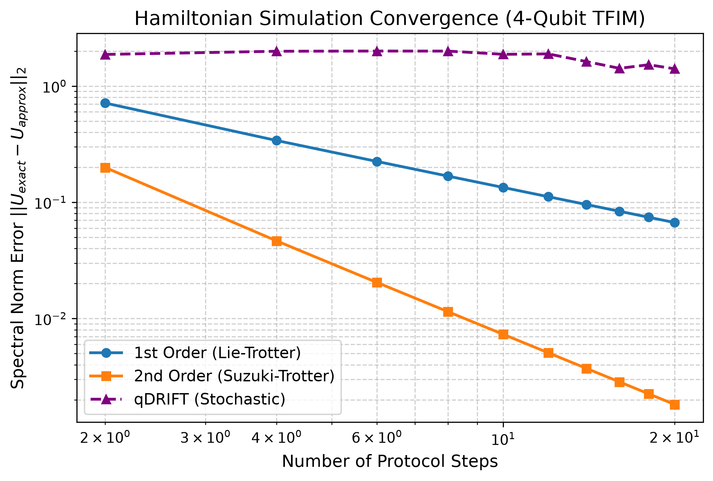
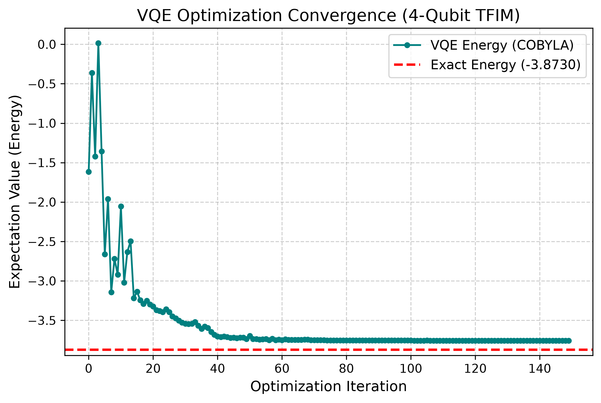

# Hamiltonian Simulation Benchmarks in Qiskit


[](https://opensource.org/licenses/Apache-2.0)

A benchmarking suite for evaluating product-formula Hamiltonian simulation algorithms (Lie-Trotter, Suzuki-Trotter) and hybrid variational workflows using Qiskit. This repository provides reproducible infrastructure for comparing approximate quantum time-evolution against exact classical baselines, with a focus on convergence scaling, error bounds, and hardware execution.

## Benchmark: Transverse-Field Ising Model (TFIM)
The primary validation model is a 1D Transverse-Field Ising Model ($H = -J \sum Z_i Z_{i+1} - h \sum X_i$). The plot below demonstrates the asymptotic scaling difference between first-order and second-order product formulas, alongside the stochastic qDRIFT protocol, as the number of time slices ($r$) increases.


*Convergence of spectral norm error* $\lVert U_{exact} - U_{approx} \rVert_2$ *for a 4-qubit TFIM (*$J=1.0$, $h=0.7$, $t=1.0$*). First-order Lie-Trotter exhibits* $\mathcal{O}(1/r)$ *scaling, while second-order Suzuki-Trotter achieves* $\mathcal{O}(1/r^2)$ *scaling. qDRIFT error is dominated by sampling variance.*

## Hybrid Quantum-Classical Workflows (VQE)
In addition to time evolution, this repository implements the Variational Quantum Eigensolver (VQE) to compute the ground-state energy of the TFIM. Utilizing Qiskit Primitives (`StatevectorEstimator`) and SciPy's COBYLA optimizer, the hybrid loop trains a parameterized hardware-efficient ansatz to approximate the exact minimum eigenvalue.


*COBYLA optimization trajectory of a 4-qubit TFIM ground state using a hardware-efficient ansatz.*

## Quickstart

This project uses Docker to ensure completely reproducible environments across Linux, macOS, and Windows without polluting your local Python environment.

### Prerequisites
- [Docker](https://docs.docker.com/get-docker/) and Docker Compose
- (Optional) An IBM Quantum token for hardware execution

### Running the Environment
Clone the repository and build the container:
```bash
git clone [https://github.com/micheleconficconi/Qiskit-hamiltonian-simulation.git](https://github.com/micheleconficconi/Qiskit-hamiltonian-simulation.git)
cd Qiskit-hamiltonian-simulation
```

**1. Run the test suite:**
```bash
docker compose run --rm bench pytest -v
```

**2. Execute the benchmark sweeps:**
```bash
# Time evolution (Trotter & qDRIFT)
docker compose run --rm bench python experiments/run_benchmark.py --config experiments/configs/tfim.yaml

# Ground state energy (VQE)
docker compose run --rm bench python experiments/run_vqe.py
```

**3. Generate the convergence plots:**
```bash
docker compose run --rm bench python experiments/plot_benchmark.py
docker compose run --rm bench python experiments/plot_vqe.py
```

## Repository Structure

```text
.
├── experiments/
│   ├── configs/            # YAML files defining experimental parameters
│   ├── fetch_hardware_results.py # IBM Quantum job retrieval script
│   ├── run_benchmark.py    # Time evolution orchestration script
│   ├── run_hardware.py     # IBM Quantum backend execution script
│   ├── run_vqe.py          # Hybrid VQE optimization script
│   └── plot_*.py           # Plotting utilities
├── src/
│   └── hamsim/
│       ├── algorithms.py   # Trotterization & qDRIFT circuit synthesis
│       ├── exact.py        # Classical exact evolution & eigenvalues
│       ├── models.py       # SparsePauliOp Hamiltonian definitions
│       └── vqe.py          # Hybrid quantum-classical optimization logic
├── tests/                  # Pytest verification suite
├── pyproject.toml          # Project metadata and dependencies
└── docker-compose.yml      # Container orchestration
```

## Hardware Execution (IBM Quantum)
To run circuits on actual IBM Quantum hardware, create a `.env` file in the root directory and add your token:
```text
QISKIT_IBM_TOKEN=your_token_here
```
The Docker environment will automatically inject this into Qiskit Runtime sessions. 
To compile circuits to the target ISA and submit them to the least busy free-tier QPU:

1) Run Trotter time evolution on IBM Quantum hardware: 
```bash
docker compose run --rm bench python experiments/run_hardware.py --mode trotter --steps 2
```
2) Evaluate trained VQE optimal parameters on IBM Quantum hardware: 
```bash
docker compose run --rm bench python experiments/run_hardware.py --mode vqe
```

Once your job is submitted, retrieve the hardware execution results using the returned Job ID:
```bash
docker compose run --rm bench python experiments/fetch_hardware_results.py --job-id <YOUR_JOB_ID>
```

## License
Distributed under the Apache 2.0 License. See `LICENSE` for more information.
